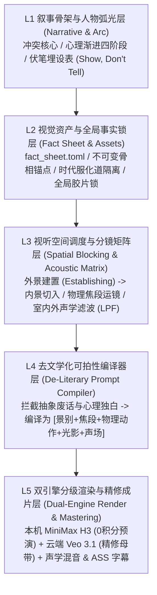

> 本文保留早期特定剧集的制片方案。当前剧情短片以[故事与表演制作方法](../.agents/skills/director-story/references/story-performance-method.md)为准：模型选择由实际试演决定；出镜对白须验证原生画音或音频条件生成；自动评分、静音检测和后配音均不能证明口型同步或作品完成。下文的固定弧光、镜头规则、模型分工和字幕做法不作为所有故事的通用要求。

# 工业化 AI 视频制作工作流：编剧与导演角色的标准化方法论与可复用 SOP

> [!IMPORTANT]
> **核心论断**：AI 视频成品的“粗糙感、套话连篇、五官漂移与空间崩塌”，并非源于底层视频生成模型算力的不足，而是源于**工作流架构的根本性错位**——试图用一个单一的“提示词输入框”去承载本应由庞大影视工业体系**分层消化的多维决策**。
> 本报告正式确立 **“五层可产品化导演决策架构 (L1–L5)”** 与 **“S1–S6 分步受控人机协同管线”**，将人类创作者从“祈祷抽中好卡的提示词输入员”，升级为掌控叙事骨架、视觉资产与空间调度的**总编剧与总导演**。

---

## 第一章 核心症结诊断：为何“直接让 AI 生成”必然导致成品粗糙？

在当前的 AI 视频制作实践中，绝大多数创作者面临的核心困境在于：当向大语言模型（LLM）或视频生成模型输入一段笼统的创意指令（如“写一个悬疑短剧脚本”或“生成一个充满电影感的雨夜追逐镜头”）时，产出的剧本往往充斥着空洞的套话与生硬的说教，而生成的画面则表现出严重的“塑料感”、人物五官漂移、空间逻辑崩塌以及叙事节奏失控。

从认知机制与工程逻辑来看，直接让 AI 包办编剧与导演工作会触发**三大结构性失效**：

### 1.1 跨层决策坍缩与上下文失忆 (Cross-Layer Decision Collapse & Context Amnesia)
* **机理**：影视创作本质上是一个**序列艺术（Sequential Art）**与**空间调度（Spatial Blocking）**的集合体，而单次提示词生成（One-Prompt Generation）缺乏持久的项目记忆与全局约束。
* **编剧端失效**：一次性要求 AI 生成完整剧本，模型会沿着训练数据的概率均值滑行，产出结构平庸、中段节奏坍塌、毫无潜台词张力、甚至把“未来伏笔直接写进第一幕台词明牌剧透”的**“及格废话（God-View Spoiler Dialogue）”**。
* **导演端失效**：若跳过分镜拆解与视觉资产锁定，直接将文本喂给视频模型，模型在每一次独立生成时都会重新“掷硬币”解算房间结构、光源方向与人物长相，导致**单镜头看似精美、多镜头拼接却完全无法成片**的割裂局面。

### 1.2 文学性语言与视听语言的维度错位 (Literary vs. Audio-Visual Dimensional Mismatch)
* **机理**：通用大语言模型在预训练阶段吸收了海量的网文、小说与书面报告，其默认输出倾向于**“不可拍的心理描写”**（如*“他内心涌起一阵苦涩”*、*“她终于意识到了真相”*）和**“无物理意义的抽象修饰词”**（如*“酷炫”*、*“史诗感”*、*“高级感”*）。
* **工程后果**：摄影机只能拍摄**物理可见的动作与光影**，麦克风只能收录**物理可听的声波与空间声学反射**，视频扩散模型（DiT）也只能理解**具体的空间几何、光影方向与运动矢量**。将无法被镜头捕捉的文学修辞直接转化为视频提示词，必然导致 AI 在画面上进行毫无逻辑的随机脑补；同时忽略声画空间一致性（例如镜头全程在紧闭门窗的室内，背景音却配着室外毫无遮挡的倾盆大雨声）。

### 1.3 概率生成模型的“均值回归”与随机漂移 (Regression to the Mean & Stochastic Drift)
* **机理**：AI 视频生成在本质上是基于高维概率分布的采样过程。
* **工程后果**：若缺乏强有力的外部工程约束（如角色设定板、不可变骨相锚点 `Immutable Face Phrase`、首尾帧锚定 `FL2VA/i2v`、明确景别与焦段参数），模型会自动退化到训练集中最常见的平庸构图——将主体死板地摆在画面正中央、施加均匀且油亮的塑料假光、辅以毫无物理重量的镜头滑行。这正是 AI 视频呈现廉价“生成感”的根本原因。

---

## 第二章 五层可产品化导演决策架构 (The 5-Layer Director Decision Architecture)

要彻底消除粗糙感，建立一套可遵循、可复用且适用于任何视频形态（剧情短片、历史正剧、商业广告 TVC、连载漫剧、知识口播及企业 SOP 视频）的工业化方法，核心在于将创作决策解耦为以下 **L1 至 L5 五个严密隔离又逐层编译的工程层级**：

### L1：叙事骨架与人物心理弧光层 (Narrative Skeleton & Psychological Arc)
1. **心理弧光渐进律（禁止瞬间接受设定）**：
   * 任何突发戏剧事件（如意外穿越、遭遇危机），主角必须经历完整的生理与心理渐进阶段：
     * `Phase 1 [日常共情/铺垫]`：处于真实生活场景中（如漫展归来翻看 Cos 照片，由己及人感慨 1800 年前的丞相）；
     * `Phase 2 [突发意外/本能反应]`：受物理因果驱动的突发变故（如前夜大雨导致次日路面湿滑引发车祸），仅有本能惊呼，无上帝视角台词；
     * `Phase 3 [生理苏醒/怀疑否认]`：落地后的生理不适（咳嗽、摸索眼镜），第一反应以为是恶作剧、剧组拍戏或幻觉；
     * `Phase 4 [证据冲击/确认觉醒]`：被真实的物理细节（刀口血迹、泥泞粮车、“汉”字帅旗、街亭军报）击碎幻想，完成时空推理与使命觉醒。
2. **契诃夫之枪静默法则与物理光学细节体现律（Show, Don't Tell 进阶）**：
   * **铺垫期静默埋设**：关键未来转折道具（如顾渊的**第二副备用远视眼镜**），在铺垫期只能作为**视觉环境道具 (`Silent Visual Prop`)** 自然出现在画面角落（如随手敞开的眼镜盒、睡前拢入双肩包），**严禁在铺垫期台词中直接点破其未来用途**。
   * **全剧禁直白验光词**：远视凸透镜（`convex eyeglass lenses`）解决 47 岁诸葛亮老花眼、以及折射寒光震慑曹魏暗哨的设定，**全剧任何阶段严禁在台词中直白说出“远视眼/老花眼/凸透镜/度数”**，必须通过三组可拍物理细节体现：① 诸葛亮烛下看竹简时伸直手臂拉远 (`at arm's length`) + 微眯眼揉眉心；② 过肩微距特写展示竹简细字经凸透镜光学放大变清晰，诸葛亮眉头舒展；③ 山间阳光/帐内火把照在镜片上折射双道冷白寒光惊退敌哨。

### L2：视觉资产与全局事实锁层 (Production Fact Sheet & Asset Lock)
* 以项目根目录的 [`fact_sheet.toml`](file:///c:/Users/Liang/Downloads/sanguo/fact_sheet.toml) 与 [`characters/profiles.toml`](file:///c:/Users/Liang/Downloads/sanguo/characters/profiles.toml) 作为唯一事实源（Single Source of Truth）：
  1. **不可变骨相短语 (`immutable_face_phrase`)**：跨现代与古代造型，锁死同一套面部骨骼、发型、眉眼与主眼镜特征描述，并强制绑定定妆母图（`i2v` / `Ref2VA`）。
  2. **全局摄影胶片锁 (`GLOBAL_STYLE_LOCK`)**：锁死 `ARRI Alexa 65 + Panavision anamorphic lens + Rembrandt chiaroscuro + Kodak Vision3 500T film grain`。
  3. **时代服化道物理隔离 (`Era Isolation`)**：现代内景/外景严禁混入古装甲胄后缀，古代战场严禁混入现代建筑元素。

### L3：视听空间调度、同房间三维拓扑与声学矩阵层 (Spatial Blocking, 3D Room Topology & Acoustic Matrix)
1. **场次空间建置律（Exterior Establishing $\rightarrow$ Interior Cut）**：
   * 凡涉及天气、环境氛围（如雨夜、风雪、战场），**第一镜必须是从室外向室内的建置镜头（Establishing Shot）**——例如透过挂满雨珠的宿舍玻璃窗看到窗内暖光下伏案的主角，随后第二镜再切入室内（Over-the-Shoulder / Medium Close-up）。
2. **同场次跨镜三维空间拓扑锁 (`[spatial_rooms]` / `room_id`)**：
   * 同一房间连续镜头（如 `dorm_room_night` 的窗外向内看 Shot 1 与室内近景 Shot 2/3）必须在 `fact_sheet.toml` 中锁死**左/中/右/前/后三维空间坐标**（如左：27寸显示器亮着漫展返图相册+黄铜暖光台灯；中前景：眼镜盒+白羽扇+青色纶巾+单反相机+双肩包；右：顾渊面朝左侧显示器），并分别绑定配对的外景透窗母图（`ep01_01_exterior_window_anchor.jpg`）与内景屏幕母图（`ep01_02_interior_cosplay_screen_anchor.jpg`），严禁发生 180° 越轴或左右陈设翻转。
   * **透窗推镜 Z 轴一致性警示**：若外景透窗镜中窗户在前景平面（$Z=0$）、人物背景是内墙/床铺（$Z=10$），切入内景同角度拍人物侧面时，需注意窗户位于前景侧方而非背景墙，防止窗户平面发生 Z 轴瞬移。
3. **声画空间物理一致性（Acoustic Space Matching）**：
   * **外景镜头 (`exterior_storm` / `ancient_battlefield`)**：环境雨声/山风保持全频段高清晰度（Volume `0.75~0.90`，无低通滤波）；
   * **关窗内景与军帐内景镜头 (`interior_closed` / `ancient_tent_interior`)**：室外雨声/寒风必须经过**物理墙体/玻璃/厚牛皮帐篷低通滤波（FFmpeg `lowpass=f=420,volume=0.18` 或 `lowpass=f=380,volume=0.22`）**转化为沉闷微弱的背景底噪，同时凸显室内/帐内近场音效（鼠标滚轮声、摩挲羽扇声、拉链声、烛火噼啪与竹简碰撞声）。
4. **跨时空匹配转场（Match Cut Transition）**：
   * 场景切换优先采用物理动势匹配（如现代雨后车祸飞旋而出的白羽扇与水花，下一帧直接接古代秦岭山道飞溅的泥浆与寒雨）。

### L4：去文学化“可拍性”与台词视觉证据对齐编译器层 (De-Literary & Visual Evidence Compiler)
* 在代码管线中内置**静态规则检查器 (`DirectorLinter`)**，所有分镜进入生成引擎前必须通过五项硬性审查：
  1. **强制物理焦段与运镜矢量 (`Camera Lens & Vector Lock`)**：每个镜头必须显式声明物理焦段（如 `28mm`, `35mm`, `50mm`, `85mm`）与运动方向。
  2. **台词指涉物与画面视觉证据强对齐 (`Dialogue Referent Visual Evidence Lock`)**：当台词提及特定媒介或现象（如“漫展拍出来”、“拨云见日”、“目中寒光”），画面 `action` 必须包含直接对应的视觉证据（如显示器展示漫展现场 Cos 诸葛亮活动相册与单反相机、凸透镜微距放大竹简细字、镜片反射双道冷白寒光）。
  3. **拦截中英文抽象文学废话 (`Bilingual Literary Vagueness Guard`)**：自动扫描并报错拦截诸如 `史诗感`、`宿命感`、`内心涌起`、`realizes the`、`feels a sense of`、`profound warmth and quiet emotion` 等不可拍词汇，强制替换为**物理动作（Physical Action）+ 光影几何（Lighting Geometry）+ 运镜矢量（Camera Vector）**。
  4. **拦截伏笔剧透、直白验光词与弧光倒退 (`Spoiler, Medical Term & Monotonic Arc Guard`)**：在铺垫期严禁台词剧透备用眼镜，全剧严禁台词直白说出“远视眼/老花眼/凸透镜”，并强制校验 `arc_phase` 单调非递减演进。
  5. **拦截声画空间违和、三维拓扑冲突与时代串戏 (`Acoustic, 3D Topology & Era Guard`)**：强制校验外景建置先行律、`[spatial_rooms]` 房间拓扑一致性、定妆母图 `ref_image` 物理存在性，以及现代/古代双向服化道隔离。

### L5：双引擎分级渲染与后期声学成片层 (Dual-Engine Render & Acoustic Mastering)
* **云地双引擎协同**：
  * **本地 `MiniMax H3` (Strix Halo 96GB ROCm，0 积分)**：负责分镜走位预演、多卡抽样测试、过场镜头渲染；
  * **云端 `Google Flow Veo 3.1` (`veo-quality` / `veo-fast` / `omni-flash`)**：负责核心人物特写、`i2v` 首帧锁定与正片母带交付。
* **物理声学混音与字幕烧录**：
  * 根据每个镜头的 `acoustic_space` 属性自动调用 FFmpeg 施加对应的声学滤波器（如 `lowpass=f=420,volume=0.18` 室内闷雨声），混入高精中文配音，并通过 `silencedetect` 烧录毫秒级对齐的 `.ass` 字幕。

---

## 第三章 标准作业程序 (SOP)：从创意到成片的六工位执行手册

| 工位 | 名称 | 输入物 | 核心动作与检验标准 (Gatekeeper Check) | 产出物 |
| :--- | :--- | :--- | :--- | :--- |
| **S1** | **叙事弧光与场次拆解** | 故事梗概 | 确立心理四阶段弧光；登记“静默视觉伏笔”（不进台词）；确保每场戏具备 `外景建置 -> 内景切入 -> 动作收尾/转场` 完整空间链。 | `episodes/epXX/script.md` |
| **S2** | **事实表与视觉资产锁定** | 角色设定 | 在 `fact_sheet.toml` 中锁死角色 `immutable_face_phrase`、定妆母图路径 (`ref_image`)、时代隔离规则与静默伏笔词表。 | `fact_sheet.toml` & 定妆母图 |
| **S3** | **去文学化分镜编译与质检** | 场次脚本 | 运行 `python run_pipeline.py --lint-ep X`，通过 `DirectorLinter` 拦截抽象词、伏笔剧透与声画违和，输出标准化 `movie.toml`。 | `episodes/epXX/movie.toml` |
| **S4** | **首帧锚定与跨镜桥接** | `movie.toml` | 生成或提取每个镜头的首帧关键帧（或上一镜尾帧 `*_endframe.jpg`），确保构图偏离平庸中心位、光影符合伦勃朗明暗比。 | 首尾帧资产库 |
| **S5** | **双引擎分级视频渲染** | 锚定帧 + 提示词 | 预演/空镜走本地 `MiniMax H3`（0积分）或云端 `Veo 3.1 Lite/Fast`；重头戏走 `Veo 3.1 Quality` (`i2v`)。 | `output/raw_clips/epXX/*.mp4` |
| **S6** | **空间声学混音与字幕母带** | 原始视频 + TTS | 自动按 `exterior / interior_closed` 施加 FFmpeg 声学滤波，混入配音，烧录 `.ass` 字幕，输出五维积分与产能精算报告。 | `output/final_episodes/*.mp4` |
